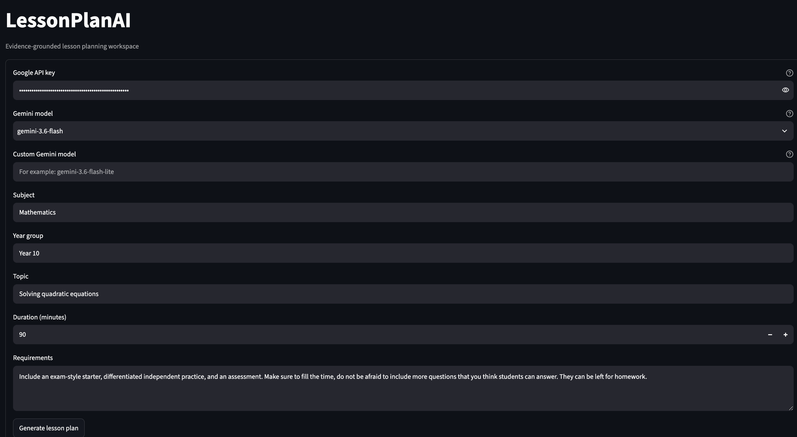

# LessonPlanAI

An AI-powered lesson planning assistant that helps teachers create evidence-based lesson plans in seconds.

This is the public repo - there are no documents. However, a demo is continuously deployed on an AWS EC2 instance [here](http://ec2-51-24-187-45.eu-west-2.compute.amazonaws.com:8501/).

